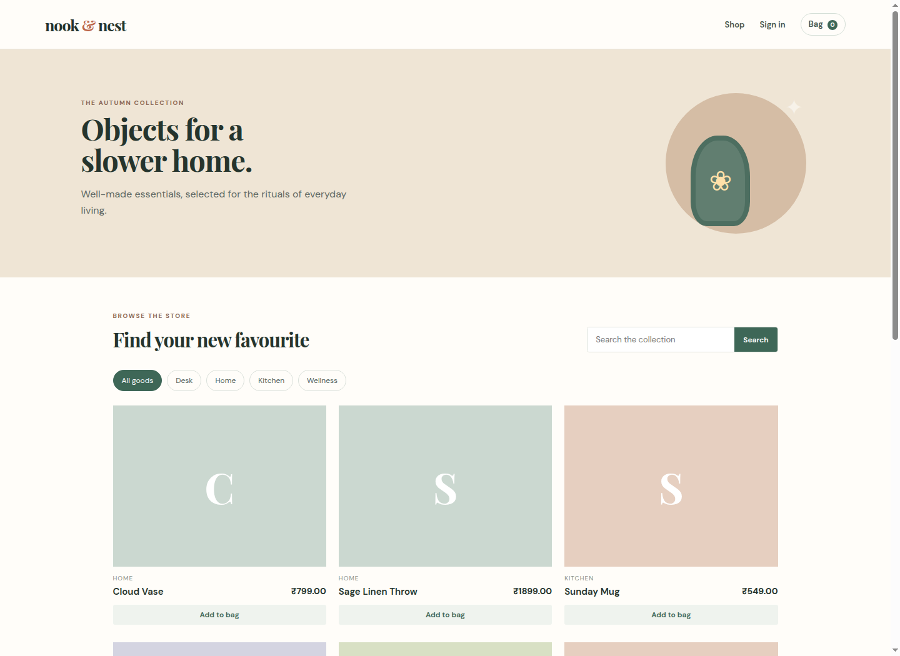
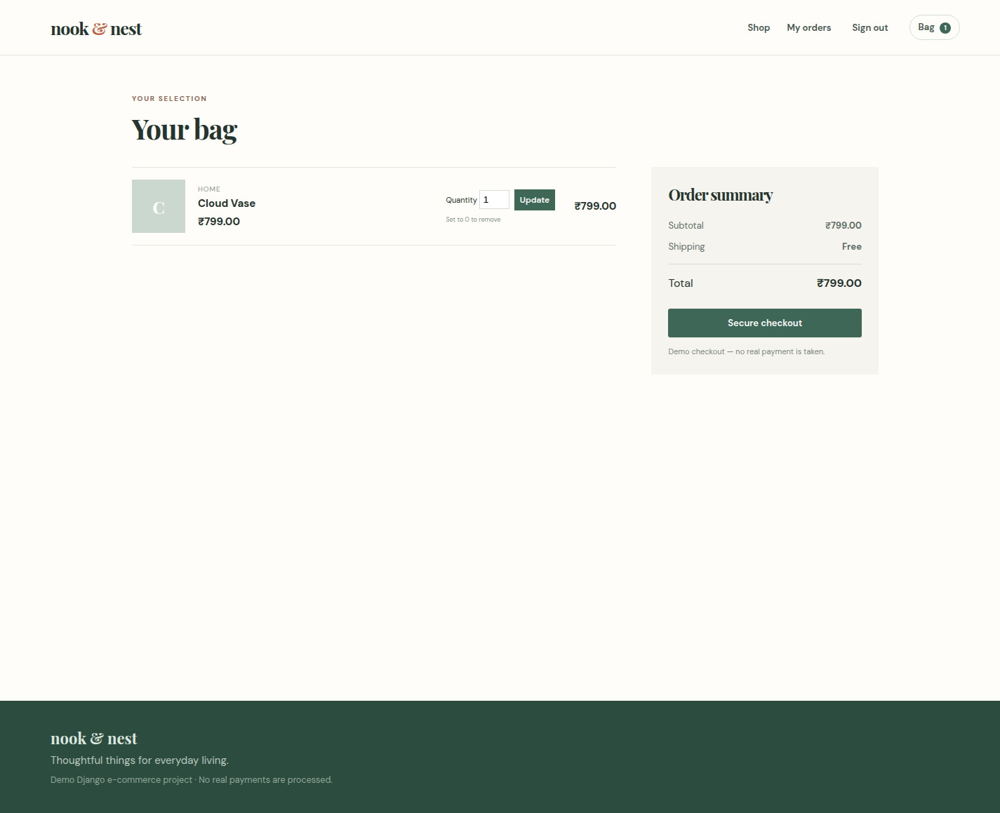
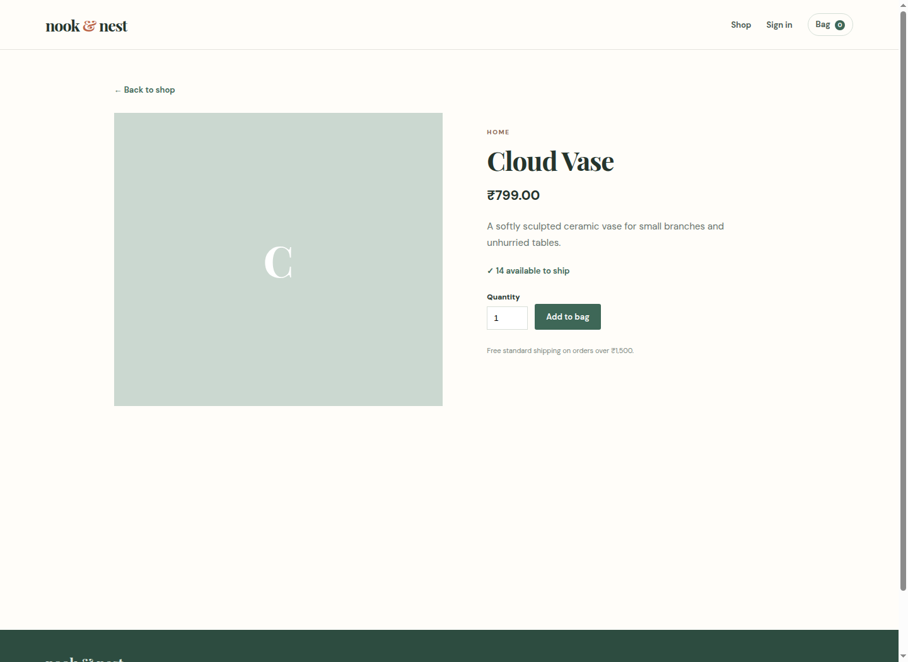
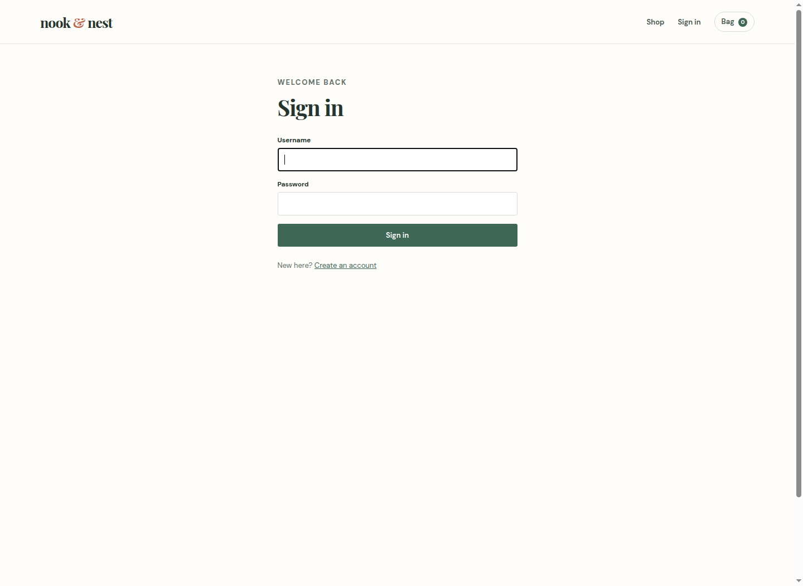

# Nook & Nest — E-commerce Website

## Project summary

Nook & Nest is a Django e-commerce application that lets customers explore a catalog, add products to a cart, create an account, complete a demo checkout, and revisit their order history. Administrators use Django’s admin dashboard to manage products, categories, inventory, and order status.

## Required-feature mapping

| Requirement | Implementation |
| --- | --- |
| Product catalog | Searchable category-based product listing and product detail pages. |
| Cart | Session cart, quantity adjustment, remove by setting quantity to zero, calculated subtotal. |
| Orders | Authenticated checkout creates immutable order and line-item records. |
| User authentication | Django register, login, logout, and customer order history. |
| Payment integration | Safe demo payment reference; documented Stripe/Razorpay integration point. |
| Admin dashboard | Django admin lists product, stock, category, order, and order-line data. |
| Inventory management | Stock count on each product; checkout locks and decrements stock atomically. |

## Architecture

```text
Customer browser → Django templates/views → Models/forms → SQLite
                               ↓
                      Session cart + user authentication
                               ↓
                    Admin dashboard (staff management)
```

## Database models

| Model | Important fields | Purpose |
| --- | --- | --- |
| Category | name, slug | Groups catalog products. |
| Product | category, name, price, inventory, active | Sellable item and available stock. |
| Order | user, address, total, status, payment_reference | Customer purchase record. |
| OrderItem | order, product, unit_price, quantity | Historical item detail for an order. |

## Payment implementation note

The project intentionally implements a **Demo Card** rather than collecting real card numbers. On checkout it creates a `DEMO-...` payment reference and marks the order paid. A real deployment should:

1. Create a server-side Stripe PaymentIntent or Razorpay Order.
2. Send only the provider’s checkout token/order ID to the browser.
3. Verify the signed provider webhook in Django.
4. Mark the order paid and decrement inventory only after verified payment.
5. Store API keys in environment variables, never in source code.

## Screens

### Product catalog



### Shopping cart



### Product details and stock availability



### User authentication



## Setup

```bash
python3 -m venv .venv
.venv/bin/pip install -r requirements.txt
.venv/bin/python manage.py migrate
.venv/bin/python manage.py seed_store
.venv/bin/python manage.py runserver
```

Create an admin user with `.venv/bin/python manage.py createsuperuser`, then visit `/admin/` to update inventory, product visibility, pricing, and order status.

## Testing

Run `.venv/bin/python manage.py test`. The included tests verify catalog output, cart insertion, and checkout inventory reduction.
